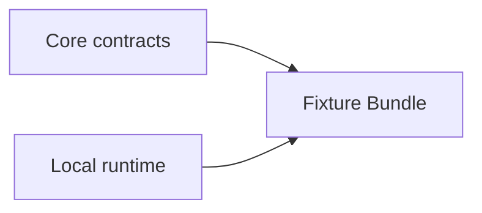

# Architecture

Fixture architecture guide used to validate copied docs extras.

The fixture separates its contracts from the runtime implementation. Weld
compiles both into the standalone package.

